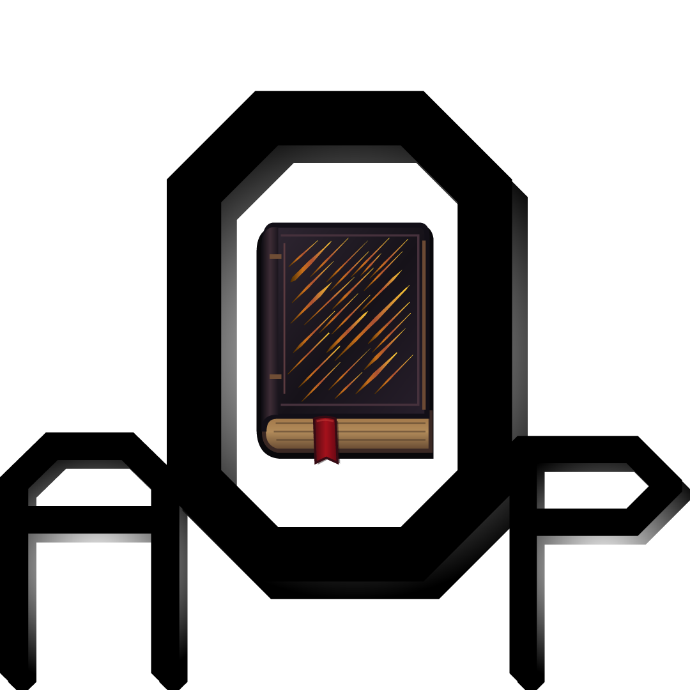

# Forbidden Magic

**Проекты AOP:** [Thaumcraft 4](https://github.com/Salossov/AOP-Thaumcraft-4) · [Compact](https://github.com/Salossov/AOPTC4-Compact) · [Thaumic Tinkerer](https://github.com/Salossov/AOPTC4-Thaumic-Tinkerer) · [AOP UI](https://github.com/Salossov/AOP-UI) · [Forbidden Magic](https://github.com/Salossov/AOPTC4-Forbidden-Magic) · [Thaumic Energistics](https://github.com/Salossov/AOPTC4-Thaumic-Energistics)

[English](README.md) · [Русский](README.ru.md)

Неофициальный порт Forbidden Magic 0.575 от SpitefulFox на **Minecraft 1.21.1 / NeoForge**. Добавляет греховные аспекты, тёмные артефакты, зачарования, жезлы, клетку гнева и интеграции с совместимыми магическими модами.

Установите игровой JAR на клиент и сервер вместе с **NeoForge 21.1.166**, **Java 21**, **AOP: Thaumcraft 4 1.1.0**, **AOP UI 0.8.0** и **Curios 9.5.0+**. Для необязательных интеграций нужны совместимые порты; старые переключатели конфига не заменяют отсутствующие зависимости. Исходная интеграция EMC для EE3 адаптирована к ProjectE. JAR исходников и API разработчика в `mods/` не устанавливаются.

**1.0.0** · WTFPL-2.0 · [История изменений](CHANGELOG.ru.md)

Mod ID NeoForge: **`forbidden_aop`**. Namespace реестров и ресурсов: **`forbidden`**. Существующие ID предметов/блоков и имена конфигов сохранены.

## Настройки

Откройте «Моды» → мод → «Настройки» либо выберите мод в AOP UI. Для всех существующих параметров добавлены русские и английские названия и подсказки. Параметры запуска требуют полного перезапуска; AOP UI показывает ожидающие применения изменения. Новые настройки баланса не добавлены.

## Сборка

Нужны Java 21, Python 3.11+, совместимые JAR AOP UI и Thaumcraft API/ядра. Для Forbidden Magic также нужны зависимости компиляции интеграций. Зависимости не встраиваются в игровой JAR.

Локальная сборка: `./gradlew.ps1 build sourcesJar` (PowerShell) либо `./gradlew build sourcesJar` (POSIX), с параметрами `-P<роль>=<абсолютный путь>` из списка ниже. Wrapper загружает закреплённую версию Gradle. В CI наши зависимости собираются автоматически из исходников.

## Непрерывная интеграция

В **Actions → Build and release → Run workflow** включите **release** для обычного релиза `v<версия>`; без флажка обновляется единственный prerelease `nightly`. Пустая **version** использует `mod_version`, переопределение задаётся как `major.minor.patch`. Pull request собирается без публикации. Существующие обычные теги не перезаписываются; примечания к релизу содержат коммиты с предыдущего релиза. Локальный `act` проверяет только план публикации и не может публиковать.

Зависимости собираются автоматически из исходников AOP UI и Thaumcraft; Forbidden Magic также собирает Thaumic Tinkerer. Репозитории и ветки можно переопределить переменными `AOPUI_REPOSITORY` / `AOPUI_REF`, `THAUMCRAFT_REPOSITORY` / `THAUMCRAFT_REF`, `TINKERER_REPOSITORY` / `TINKERER_REF` по необходимости. Для закрытых репозиториев нужен `DEPENDENCY_TOKEN` с Contents read; для публичных отдельный токен не нужен. URL и SHA-256 архива в настройках репозитория не требуются. Кеш проверяется по ревизиям, содержимому исходников, окружению сборки и хешам зависимостей. Workflow публикует только текущий мод.

Манифест зависимостей и SHA-256 создаются и проверяются автоматически. Внешние зависимости компиляции FM скачиваются по закреплённым ссылкам из [.github/ci-external.json](.github/ci-external.json), с проверкой хеша и mod ID. Результат включает игровые JAR, исходники, `SHA256SUMS.txt` и сведения о сборке.

Для локального `act` подготовьте исходники в `.dependencies/aopui`, `.dependencies/thaumcraft` и (только FM) `.dependencies/tinkerer` либо укажите `SUITE_*_ROOT`. Для экспортированных checkout нужны игнорируемые `.suite-source.json`, а для текущего мода используйте `python .github/scripts/ci.py inventory`. Локально публикация всегда проверяется через dry run.

## Графика и авторство

Авторы и условия сторонних материалов: [LICENSE](LICENSE), [NOTICE.md](NOTICE.md). Этот проект не меняет лицензии зависимостей и отдельного ядра Thaumcraft.

Обязательные роли зависимостей: `thaumcraftApiJar`, `thaumcraftRuntimeJar`, `aopUiJar`, `botaniaJar`, `bloodMagicJar`, `modopediaJar`, `tinkererJar`.

Набор совместимости для сборки: Botania 456 (закреплённая публичная Maven-сборка), Blood Magic 3.4.0-46-alpha, Modopedia 1.1.5 и Thaumic Tinkerer 1.1.0. Эти зависимости компиляции и проверок не становятся обязательными для игрока.

- SpitefulFox: оригинальный Forbidden Magic.
- [Salossov](https://github.com/Salossov): порт и сопровождение.
- NeoForge, AOP: Thaumcraft 4, AOP UI и проекты интегрируемых модов: платформа и API.
